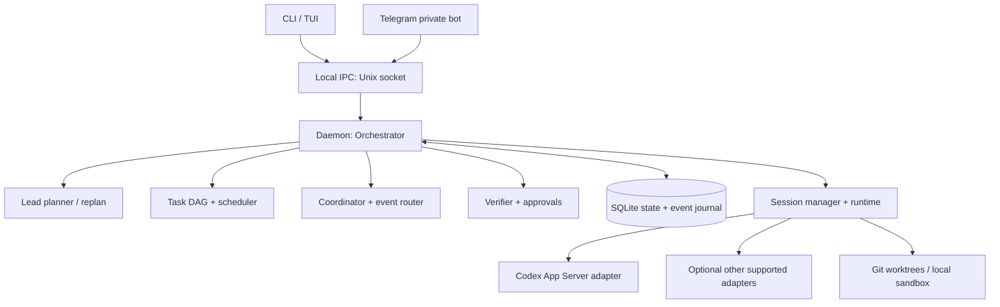

# Takt (working name) — lightweight hybrid agent orchestration in Rust

> **Status: M0 offline orchestration foundation with a scripted mock backend.**
>
> **Naming:** This repo is named `takt-rs` to distinguish it from existing projects using the name TAKT/takt. The eventual public name must be reviewed before release.

Takt is building toward a **local-first daemon** that delegates work to supported AI coding backends, stores the task DAG, coordinates agent communication, manages native provider sessions, and verifies outcomes. The planned CLI, TUI, and Telegram interfaces share one daemon.

In the planned workflow, a lead agent proposes the plan, Rust validates and schedules it, and specialist agents implement it in isolated worktrees. Tests and a reviewer provide evidence for human merge approval.

## Principles

1. Small native Rust process; SQLite + Unix socket; no Redis, cloud dashboard, or Docker dependency for basic operation.
2. An agent is a logical worker, not a permanently running expensive model session.
3. Provider-native sessions, structured events, bounded execution; explicit capability checks.
4. Plan with AI; **enforce with deterministic code** (DAG, permissions, retries, approvals, resource budgets).
5. No bypass of provider account limits, account rotation, unofficial token extraction, or blanket `--yolo` defaults.
6. Local Git worktrees separate edits; they are **not** a security sandbox.
7. Durable task state and events; recovery must not silently duplicate side effects.
8. Optional Telegram control via authenticated private chat using long polling.

## Repository map

- [`docs/VISION.md`](docs/VISION.md) — target users, differentiators, scope, success definition.
- [`docs/PRD.md`](docs/PRD.md) — behaviors, user journeys, functional/nonfunctional requirements.
- [`docs/ARCHITECTURE.md`](docs/ARCHITECTURE.md) — components, data flow, event-driven orchestration.
- [`docs/DOMAIN.md`](docs/DOMAIN.md) — task graph, state transitions, SQLite schema, invariants.
- [`docs/PROVIDERS.md`](docs/PROVIDERS.md) — official adapters, session lifecycle, result contracts.
- [`docs/TELEGRAM.md`](docs/TELEGRAM.md) — remote command behavior, authentication, approval workflow.
- [`docs/SECURITY.md`](docs/SECURITY.md) — threats, provider/auth policy, isolation, secrets, approval gates.
- [`docs/IMPLEMENTATION.md`](docs/IMPLEMENTATION.md) — milestones, tickets, acceptance criteria, out-of-scope.
- [`docs/TEST_PLAN.md`](docs/TEST_PLAN.md) — fast deterministic tests and acceptance scenarios.
- [`docs/OPERATIONS.md`](docs/OPERATIONS.md) — setup, service lifecycle, troubleshooting, backup.
- [`docs/REFERENCES.md`](docs/REFERENCES.md) — official docs and decisions requiring reconfirmation.
- [`AGENTS.md`](AGENTS.md) — working agreements for coding assistants.
- [`prompts/START_AGENT.md`](prompts/START_AGENT.md) — copy/paste implementation kickoff.
- [`prompts/M0_FOUNDATION.md`](prompts/M0_FOUNDATION.md) — deliberately narrow first coding milestone.
- [`examples/config.example.toml`](examples/config.example.toml) — future daemon configuration.
- [`examples/workflow.oauth.example.json`](examples/workflow.oauth.example.json) — proposed plan contract.

## Planned architecture



## Planned CLI commands

```bash
takt daemon start
takt project add steadlume ~/projects/steadlume
takt agent ls
takt run steadlume 'Implement Google OAuth with tests'
takt plan show <workflow-id>
takt workflow status <workflow-id>
takt review <workflow-id>
takt approve <approval-id>
takt tui
```

## Run M0 offline

With a Rust toolchain installed:

```bash
cargo run --offline -- doctor
cargo run --offline -- demo
cargo fmt --all -- --check
cargo clippy --offline --all-targets -- -D warnings
cargo test --offline --all-targets
```

The demo starts two simulated developers in separate role slots. One asks the other
about the response contract and waits for the correlated answer. After both
developers pass simulated verification, a verifier runs the integration task.
The trace ends at a simulated merge approval gate with no Git operations.

- Versioned Rust plans validate dependencies, graph size and depth, acceptance
  criteria, and requested workspace-relative paths against trusted scope roots.
  Path validation is lexical. Filesystem containment and symlink handling belong
  to the later workspace and sandbox implementations.
- The in-memory scheduler uses one slot per agent, caps global parallelism, and
  uses task priority and ready order for dispatch. A provider result enters
  verification. Only a trusted verification pass unlocks dependent tasks.
- Mock sessions route help between active attempts at turn boundaries. An
  attempt can ask for help once and keeps its slot while blocked. If no answer
  arrives, the task can be cancelled. Failed or cancelled prerequisites leave
  dependent tasks queued.
- Transient mock failures retry within the configured attempt budget. Running
  tasks wait for mock cancellation acknowledgement. Runtime loss moves active
  tasks to interrupted, and a retry requires explicit reconciliation.
- Workflow state, mailbox, and events live in memory. Verification, recovery,
  and approval are simulations. The daemon and SQLite are M1, real provider
  execution is M2, worktrees and approval enforcement are M3, and Telegram and
  TUI are later milestones.

See the [implementation plan](docs/IMPLEMENTATION.md).

## Initial scope and provider policy

Codex App Server over **local stdio** is the primary real adapter after a mock backend. Gemini or other providers are follow-on adapters only after validating permitted authentication and API/CLI contracts. Avoid assuming that automation through a consumer subscription is allowed for every provider. A provider may be marked unavailable without halting the rest of the daemon.

**Repository license:** undecided for the private prototype. No open-source license grant is implied by this scaffold. Choose a license and perform name/conflict checks before publication.
