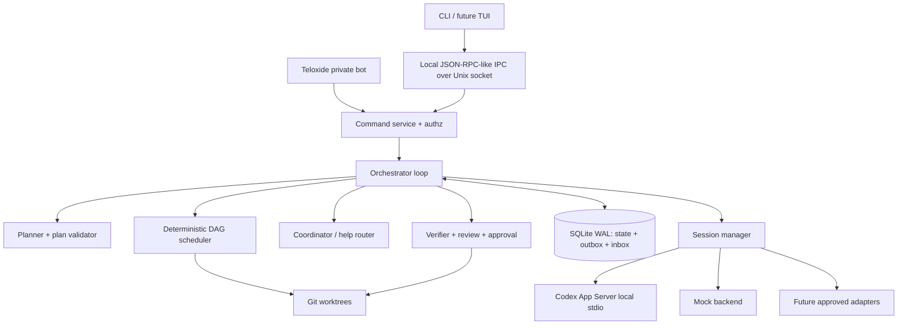
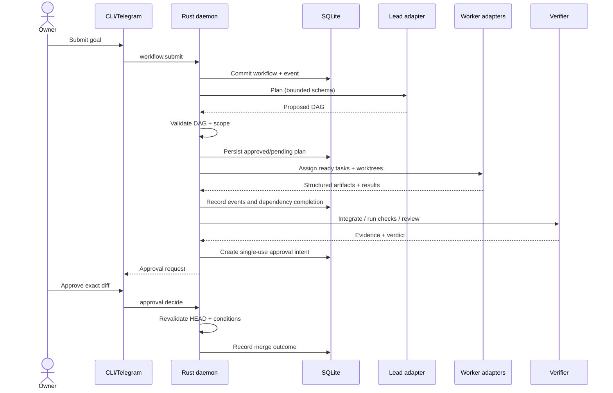

# Architecture — Hybrid Orchestrator

## System boundary

A **single-writer Rust daemon** owns durable workflow, agent and session state. CLI/TUI/Telegram are thin control planes. The lead planner is an on-demand agent, not the scheduler. No client or agent writes SQLite directly.



## Component responsibilities

**Command service:** validates input and actor permissions, persists intent, returns workflow/action ID immediately. No long-running LLM call inside the IPC handler.

**Lead:** on demand for task decomposition, interface contract, blocker resolution, and bounded replanning. May propose changes; cannot bypass Rust policy or perform merge.

**Planner/validator:** strict versioned schema, max DAG size and depth, unique IDs, no self-edge/cycles, existing dependencies, path policy, verification requirements, max tokens/attempts. Requires an explicit plan approval for high-risk or broad scope.

**Scheduler:** selects READY tasks by priority and earliest dependency resolution, atomically creates assignment attempts under global and per-agent concurrency limits, emits dispatch outbox record. Does not use an LLM to decide availability.

**Coordinator:** durable mailbox; handles help/request-info/artifact and escalations. All agent-to-agent messages are addressed and correlated. No unrestricted direct peer processes.

**Runtime/session manager:** provider-normalized start/send/resume/cancel/stream interfaces, health checks, process supervision, per-session turn exclusivity. Native session IDs are always private implementation fields.

**Workspace manager:** validate repository root and baseline SHA, create per-task worktree/branch, collect Git diff/commit evidence, reserve integration worktree; never wipe unrelated changes.

**Verifier:** run explicit allowlisted argv commands in a restricted execution context, record exit code/artifact digest; reviewer sees evidence, not self-reported “tests passed.”

**Approval manager:** single-use, expiring records; expected commit/head/diff digest; no silent auto-merge or deploy.

## Execution sequence



## IPC boundaries

- Unix socket at `${XDG_RUNTIME_DIR}/takt-rs/daemon.sock`; create directory `0700`, socket `0600`. Verify peer UID where supported.
- JSONL envelope: `id`, `method`, `params`, `protocol_version`; response has `id`, `result` or typed `error`. Events stream on a separate subscription command or a dedicated connection.
- No generic shell-execution method. Each method maps to authorized, predeclared operations.
- Client should reconnect with `after_seq` to replay retained events; bounded backlog and rate control.

Example request:

```json
{"protocol_version":1,"id":"req-1","method":"workflow.submit","params":{"project_id":"steadlume","request":"Implement OAuth login"}}
```

Example response:

```json
{"protocol_version":1,"id":"req-1","result":{"workflow_id":"wf_01","state":"planning"}}
```

M1 implements a subset of this interface. It uses one versioned JSON line per
connection with typed commands and responses. Both ends check peer UID on
Linux. Event reads are paginated by workflow and sequence. The CLI follows
events by polling with the last seen sequence and reconnects after brief socket
loss. M1 uses the default socket path above when `XDG_RUNTIME_DIR` is set and
supports overrides documented in the README.

## Transaction + outbox protocol

1. In a SQLite transaction, validate task readiness, reserve agent slot, create `attempt` with lease token, move task to RUNNING, append `task.started` event, create an outbox dispatch command.
2. Commit transaction.
3. Dispatcher reads pending outbox; performs external provider start once to extent possible; stores remote operation/thread ID and marks outbox acknowledged.
4. If daemon crashes between provider start and acknowledgment, mark attempt UNKNOWN/INTERRUPTED; reconcile native session/turn status before any retry. Do not assume exactly-once external execution.
5. Inbox consumes provider events with native event identifiers or local monotonic sequence and suppresses duplicate terminal transition.

SQLite transactions guarantee state consistency but **cannot** guarantee exactly-once effects in a process outside the database. Honest recovery and idempotency are required.

## Task execution protocol

- DAG edges express prerequisites. A dependent task runs only after predecessors are COMPLETED and verification gates satisfied.
- Worker results include changed files, commit SHA, tests claimed, produced artifact paths, blockers. Compare these against actual Git and verifier observations.
- Coordinator never broadcasts raw repo content to all agents by default; send minimal context and approved contract artifacts.
- `workflow.pause` prevents new assignments but does not kill active runs; `workflow.cancel` requests cancellation and persists a terminal intention.
- A retry creates a **new attempt ID**; session reuse is allowed only if provider and task boundary support it.

## Session management

`agent` != `session` != `turn` != `attempt`.

- Agent: identity/role/limits.
- Session: native conversation identity bound to provider + workspace + policy.
- Turn: single in-flight model request within a session.
- Attempt: one specific scheduler dispatch for a task; may use one or more turns.

When daemon restarts, sessions go to RECONCILING, not assumed ACTIVE. Reconnect or resume through **documented** adapter APIs; if no native resume, create a new session with explicit summary and disclosure that full history was not preserved.

## Sandbox boundary

Worktree isolation is not a security boundary. Backend process may inherit filesystem access and OS privileges unless constrained. MVP uses provider-native approval/sandbox policies plus explicit allowlisted verifier commands; for enforcing a hard path boundary, introduce bubblewrap/container/OS sandbox and fail closed when unavailable for high-risk tasks. Do not claim a path allowlist alone confines tools.

## Migration strategy

Start with fake provider and SQLite, then Codex App Server. Avoid implementing cross-platform PTY emulation or remote workers before the core DAG/recovery contract is proven.
