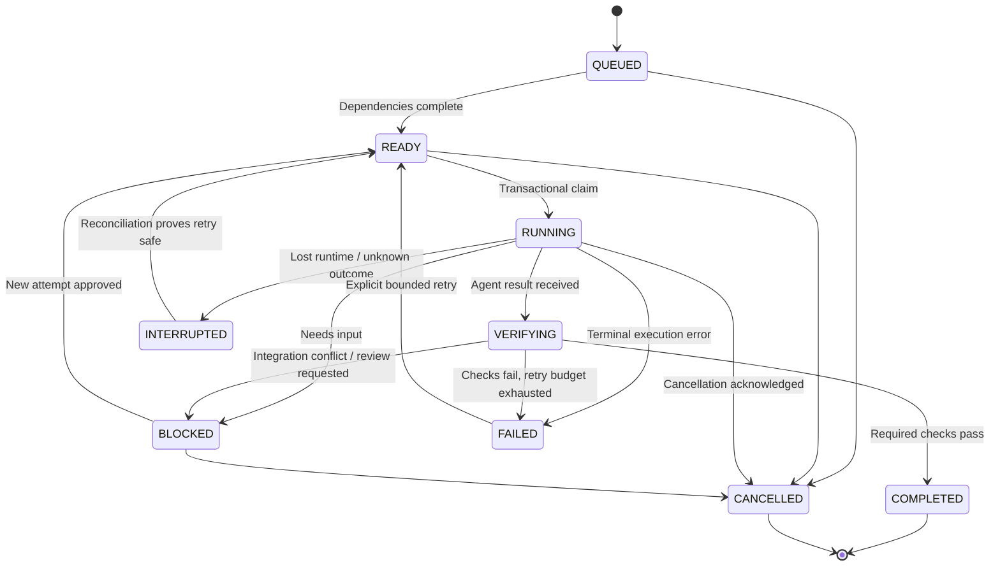

# Domain Model, State Machines, and Persistence

## Vocabulary

- **Project:** owner-approved canonical Git repository directory.
- **Workflow:** one user goal, plan, budget, baseline commit, and output.
- **Plan:** immutable revisioned DAG proposal plus acceptance conditions.
- **Task:** bounded unit of work; task states drive dependencies.
- **Attempt:** one execution assignment with unique token and lease; retries are new attempts.
- **Agent:** logical identity and role; references a provider profile.
- **Session:** native provider conversation in an explicit working directory.
- **Turn:** one provider interaction with a start and terminal outcome.
- **Message:** durable addressed inter-agent collaboration request/answer.
- **Artifact:** Git SHA/diff, generated file, check report, or structured result.
- **Approval:** human authorization for an exact action and immutable target.

## Task transition policy



A task in COMPLETED is immutable for the current plan revision. To redo it, create a new revision/task ID. `AWAITING_APPROVAL` belongs to a **workflow gate or approval record**, not a developer task's terminal status. Workflow statuses: PLANNING, PLAN_REVIEW, RUNNING, PAUSED, BLOCKED, VERIFYING, AWAITING_APPROVAL, MERGING, COMPLETED, FAILED, CANCELLED.

## Invariants

1. Every workflow has one immutable baseline SHA for a particular plan revision.
2. Every plan is validated for missing references, cycles, role compatibility, scope, max size, max depth, and required evidence.
3. Only one active attempt per task. Unique constraint on `(task_id)` for active attempt via partial index or transactional predicate.
4. Only one in-flight turn per native session. Don't hand off session ownership between concurrent agents.
5. Terminal completion requires verified artifacts and the appropriate checks, not a model's success claim.
6. State transition + append event + dispatch intent happen in one SQLite transaction.
7. Outbox deliveries may repeat; external actions are not assumed exactly once.
8. An interrupted attempt with unknown side effects cannot auto-retry until reconciled or explicitly approved.
9. Every merge approval binds target branch, expected HEAD SHA, source SHA/diff digest, expiry, actor, and one-time decision.
10. Every persisted artifact path is relative to an approved workspace or a managed artifacts root; reject `..`, symlink escapes, and unexpected absolute paths.
11. No cross-project access through provider session reuse.
12. No provider credential stored in task metadata, events, bot message, or logs.

## Suggested schema, initial migration

SQLite SQL (draft to convert into `migrations/0001_initial.sql` during M1):

```sql
PRAGMA foreign_keys=ON;
CREATE TABLE projects (
  id TEXT PRIMARY KEY,
  root TEXT NOT NULL UNIQUE,
  created_at INTEGER NOT NULL
);
CREATE TABLE workflows (
  id TEXT PRIMARY KEY,
  project_id TEXT NOT NULL REFERENCES projects(id),
  request TEXT NOT NULL,
  baseline_sha TEXT NOT NULL,
  plan_revision INTEGER NOT NULL DEFAULT 0,
  state TEXT NOT NULL,
  created_at INTEGER NOT NULL,
  updated_at INTEGER NOT NULL
);
CREATE TABLE tasks (
  id TEXT PRIMARY KEY,
  workflow_id TEXT NOT NULL REFERENCES workflows(id),
  plan_revision INTEGER NOT NULL,
  title TEXT NOT NULL,
  role TEXT NOT NULL,
  payload_json TEXT NOT NULL,
  state TEXT NOT NULL,
  priority INTEGER NOT NULL DEFAULT 0,
  active_attempt_id TEXT,
  version INTEGER NOT NULL DEFAULT 0
);
CREATE TABLE task_dependencies (
  task_id TEXT NOT NULL REFERENCES tasks(id),
  dependency_task_id TEXT NOT NULL REFERENCES tasks(id),
  PRIMARY KEY(task_id,dependency_task_id),
  CHECK (task_id <> dependency_task_id)
);
CREATE TABLE agents (
  id TEXT PRIMARY KEY,
  role TEXT NOT NULL,
  provider_profile TEXT NOT NULL,
  enabled INTEGER NOT NULL DEFAULT 1,
  max_concurrency INTEGER NOT NULL DEFAULT 1
);
CREATE TABLE sessions (
  id TEXT PRIMARY KEY,
  agent_id TEXT NOT NULL REFERENCES agents(id),
  provider TEXT NOT NULL,
  native_id TEXT,
  worktree TEXT NOT NULL,
  status TEXT NOT NULL,
  current_turn_id TEXT,
  updated_at INTEGER NOT NULL
);
CREATE TABLE attempts (
  id TEXT PRIMARY KEY,
  task_id TEXT NOT NULL REFERENCES tasks(id),
  agent_id TEXT NOT NULL REFERENCES agents(id),
  session_id TEXT REFERENCES sessions(id),
  lease_token TEXT NOT NULL UNIQUE,
  lease_expires_at INTEGER NOT NULL,
  state TEXT NOT NULL,
  started_at INTEGER NOT NULL,
  ended_at INTEGER
);
CREATE UNIQUE INDEX one_active_task_attempt
  ON attempts(task_id)
  WHERE state IN ('CLAIMED','RUNNING','RECONCILING');
CREATE TABLE events (
  seq INTEGER PRIMARY KEY AUTOINCREMENT,
  workflow_id TEXT,
  type TEXT NOT NULL,
  payload_json TEXT NOT NULL,
  created_at INTEGER NOT NULL
);
CREATE TABLE outbox (
  id TEXT PRIMARY KEY,
  event_seq INTEGER NOT NULL REFERENCES events(seq),
  action TEXT NOT NULL,
  payload_json TEXT NOT NULL,
  state TEXT NOT NULL,
  attempts INTEGER NOT NULL DEFAULT 0
);
CREATE TABLE mailbox (
  id TEXT PRIMARY KEY,
  workflow_id TEXT NOT NULL REFERENCES workflows(id),
  source_task_id TEXT REFERENCES tasks(id),
  target_task_id TEXT REFERENCES tasks(id),
  correlation_id TEXT,
  kind TEXT NOT NULL,
  body_json TEXT NOT NULL,
  state TEXT NOT NULL,
  created_at INTEGER NOT NULL,
  delivered_at INTEGER
);
CREATE TABLE artifacts (
  id TEXT PRIMARY KEY,
  task_id TEXT NOT NULL REFERENCES tasks(id),
  kind TEXT NOT NULL,
  rel_path TEXT,
  sha256 TEXT,
  metadata_json TEXT NOT NULL
);
CREATE TABLE approvals (
  id TEXT PRIMARY KEY,
  workflow_id TEXT NOT NULL REFERENCES workflows(id),
  action TEXT NOT NULL,
  target_ref TEXT NOT NULL,
  expected_target_sha TEXT NOT NULL,
  source_sha TEXT NOT NULL,
  diff_sha256 TEXT NOT NULL,
  expires_at INTEGER NOT NULL,
  state TEXT NOT NULL,
  decided_by TEXT,
  decided_at INTEGER,
  nonce_sha256 TEXT NOT NULL UNIQUE
);
```

**Known follow-ups:** enforce cross-workflow dependency checks in application code and test; reject invalid state strings with enums/conversion; add `schema_version` and migrations; event retention/backups; add active session uniqueness and correlation constraints. Do not treat schema alone as sufficient policy.

## Ready-task selection

Pseudocode:

```text
for workflow in RUNNING (priority, created_at):
    for task in workflow.tasks with state QUEUED:
        if all predecessors COMPLETED and all required artifacts checked:
            transition task to READY with event
    for ready task:
        select agent with matching role/capability + available slot
        claim in DB transaction and append dispatch outbox
```

Only a single scheduler writer in MVP. Still use transactions and unique constraints to catch bugs and avoid double dispatch after restart.

## Retry categories

| Category | Retry behavior |
|---|---|
| Validation error | Never auto-retry; repair plan/input |
| Provider auth / quota / policy refusal | Pause provider and surface to owner; do not rotate accounts |
| Temporary provider transport error | Bounded exponential retry if no side effects occurred |
| Crash during tool execution | INTERRUPTED; reconcile; do not repeat blindly |
| Test failure | Send evidence to responsible developer; bounded new attempt |
| Review finding | Rework task with explicit updated acceptance criteria |
| Git conflict | BLOCKED; owner/lead resolves in integration worktree |

## Evidence semantics

Each check result records: `task_id`, command ID, argv, cwd, exit_code, started/finished timestamps, output digest, truncated log path, sandbox/profile, and `checked_commit_sha`. Checks are stale when the commit changes. Review result must reference the same integrated commit SHA.
